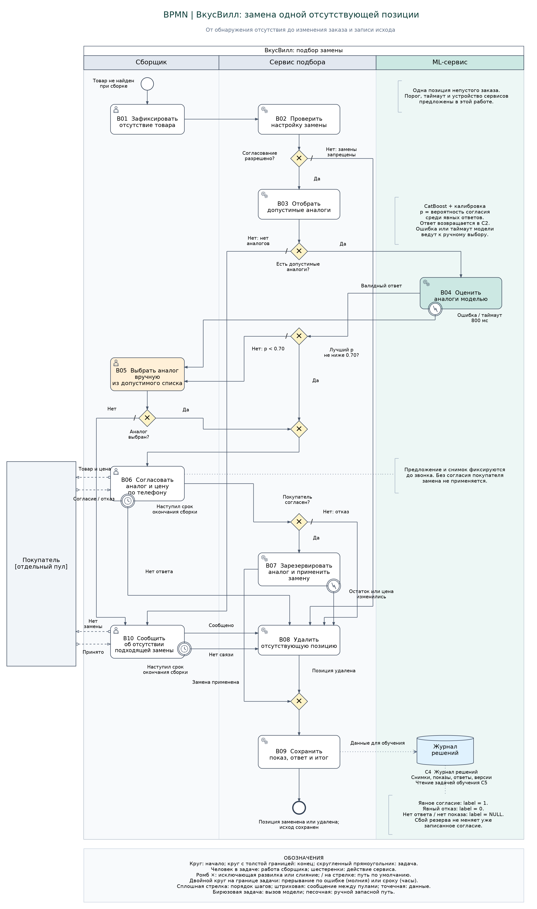
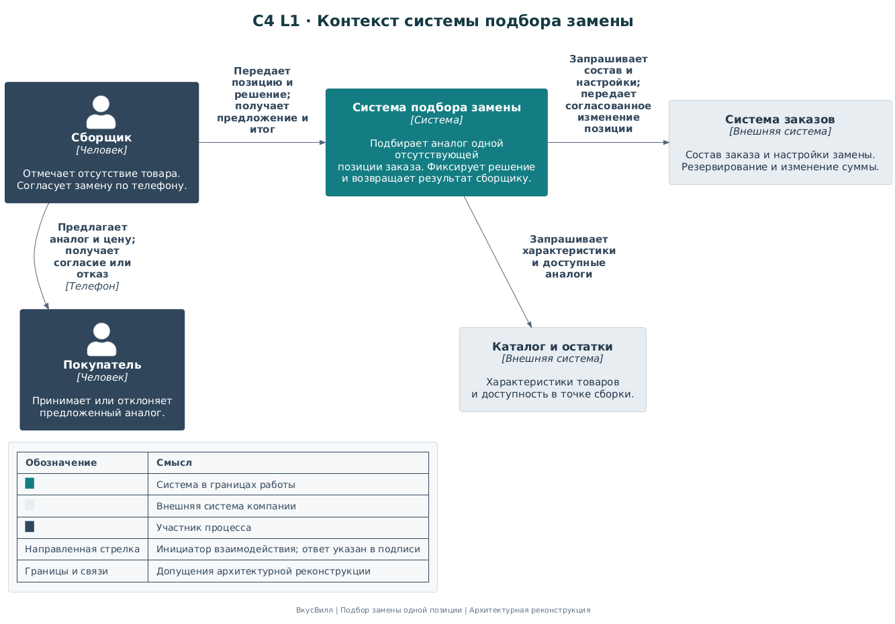
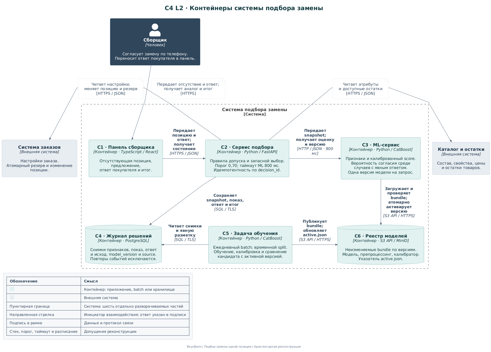
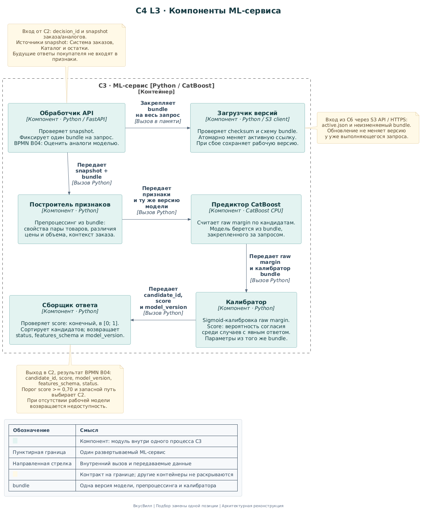

# ВкусВилл: подбор замены отсутствующего товара

В работе разобран один случай: при сборке заказа не нашлось одной позиции, а остальные товары есть. Модель помогает сборщику выбрать подходящий аналог. Покупатель подтверждает конкретный товар и цену, после чего позиция заменяется. При отказе, отсутствии связи или подходящего аналога позиция удаляется.

Это архитектурная реконструкция. В репозитории находятся схемы процесса и устройства системы, а не работающий сервис ВкусВилл. Технологии и численные ограничения предложены для этой работы.

## Границы процесса

Начало процесса: сборщик отметил отсутствие товара. Конец: система заказов подтвердила замену или удаление позиции, а исход записан в журнал решений. Если система заказов недоступна, операция остается незавершенной.

Рассматриваются штучные фасованные продукты с сопоставимыми единицами продажи. За рамками остались весовые товары, отмена всего заказа, доставка, платежи, возвраты и управление ассортиментом. Отдельный случай, когда нет ни одного товара из заказа, также не входит в схему.

ML-сервис возвращает результат сервису подбора. Выбранный аналог появляется в панели сборщика, который согласует его с покупателем по телефону. Цель: сократить число удаленных позиций и время поиска замены. Решение о замене остается за покупателем.

## Что известно по открытым источникам

В поддержке ВкусВилл описаны две настройки: согласовать изменение заказа звонком либо не звонить и не заменять отсутствующие товары. В первом случае сборщик связывается с покупателем, во втором отсутствующая позиция удаляется [1].

Пункт 3.3 публичной оферты предусматривает корректировку заказа при отсутствии товара. Если связаться с покупателем до окончания сборки не удалось, отсутствующие товары удаляются. Если отсутствуют все товары и связаться с покупателем не удалось, заказ отменяется. Этот случай находится за выбранными границами [2].

Команда ДатаЛаб (ГК Автомакон) описала ML-подбор аналогов для ВкусВилл на случай отсутствия товара в онлайн-каталоге [6]. Это подтверждает применение ML к поиску аналогов, но не устройство подсказок сборщику или модель вероятности согласия покупателя.

Для этой работы выбран этап сборки уже оформленного заказа: у него есть конкретный участник, отсутствующий товар и проверяемый итог. Наличие ML-подсказки именно на этом этапе, алгоритм оценки согласия и техническая архитектура ниже являются допущениями.

## Задача модели

Модель оценивает вероятность согласия с **конкретным озвученным аналогом среди случаев с явным ответом покупателя**. Это бинарная классификация: CatBoostClassifier и отдельно обучаемый sigmoid-калибратор. Оценки используются для выбора одного кандидата. Модель не прогнозирует вероятность ответа на звонок или успешного резервирования и не подтверждает замену.

До вызова ML сервис подбора получает из системы заказов настройку замены, исходную позицию, цену, ограничения и дедлайн сборки. Из каталога поступают характеристики аналогов и остатки нужного магазина. Сервис сохраняет снимок этих данных и применяет жесткие правила:

- сопоставимые назначение, формат и единица продажи;
- соответствие явно заданным ограничениям;
- наличие товара в нужном магазине;
- цена одной заменяющей позиции не выше 120% исходной;
- обязательные характеристики заполнены.

Отсутствие обязательного атрибута исключает товар из списка. Если допустимых кандидатов больше 50, сначала отбираются ближайшие по относительному отклонению объема упаковки, затем по отклонению цены за единицу. При равенстве используется `product_id`. В модель передаются первые 50 товаров из этого порядка. Ручной выбор работает с тем же списком и теми же ограничениями. Свободный комментарий читает сборщик: модель не определяет аллергию или другие ограничения по косвенным признакам.

Вход ML-сервиса: исходный товар, допустимые кандидаты и снимок контекста. Построитель признаков рассчитывает сходство категории, формы и фасовки, относительную разницу цены и другие зафиксированные характеристики пары товаров. Признаки формируются только из информации, доступной в момент решения.

Ответ содержит `candidate_id`, `score`, `model_version`, `features_schema` и `status`. Поле `score` хранит калиброванную вероятность `p`: согласие при условии, что предложение озвучено и получен явный ответ. При валидном ответе и `p >= 0.70` лучший кандидат автоматически предлагается **сборщику**. При меньшем значении, некорректном ответе, отсутствии рабочей версии или превышении 800 мс включается ручной выбор из того же допустимого списка. Порог 0.70 и таймаут 800 мс выбраны предварительно. Их значения требуют проверки на накопленных ответах покупателей.

## BPMN: от отсутствия товара до изменения заказа



[Схема в SVG](diagrams/01-process.svg) · [Исходник BPMN](diagrams/01-process.bpmn)

На схеме два пула: покупатель и ВкусВилл. Во втором выделены дорожки сборщика, сервиса подбора и ML-сервиса. Между пулами проходят сообщения, внутри процесса используются потоки управления. Исключающие шлюзы обозначают выбор одной ветки; граничные события показывают ошибки и истечение срока ожидания.

Проверка настройки замены идет раньше отбора аналогов. Если замены запрещены, позиция удаляется без ML и звонка. Если подходящих аналогов нет или сборщик ничего не выбрал вручную, выполняется B10: сборщик сообщает об отсутствии подходящей замены, после чего позиция удаляется. Это уведомление без предложения другого товара. Если до дедлайна сборки связаться не удалось, граничный таймер B10 также ведет к удалению. Недоступность модели и низкая оценка приводят к ручному выбору с прежними ограничениями.

Сборщик согласует один аналог и его цену. Срок ожидания ограничен дедлайном сборки, полученным из системы заказов. После явного согласия команда применения замены повторно проверяет остаток и цену. Если товар уже недоступен или условия изменились, позиция удаляется без второго круга предложений. Ответ, полученный после закрытия позиции, не меняет итог.

Замена выполняется атомарной командой системы заказов с ключом `(decision_id, action)` и версией заказа. Повтор одной команды использует тот же ключ. У замены и удаления разные значения `action`, поэтому это разные команды даже при одинаковом `decision_id`. Сервис перечитывает актуальную версию заказа и удаляет только исходную отсутствующую строку. Недоступность системы заказов оставляет статус `pending`: сохраняется тот же ключ, выполняется повтор, при длительной ошибке нужна ручная сверка. Такие технические повторы скрыты внутри задач применения и удаления. Конечное событие достижимо только после подтвержденного изменения и сохранения исхода.

## C4: три уровня одной системы

### Context



[Схема в SVG](diagrams/02-context.svg) · [Исходник PlantUML](diagrams/02-context.puml)

В центре находится «Система подбора замены». Внешние системы: «Система заказов» и «Каталог и остатки». Сборщик работает с подбором, покупатель общается со сборщиком по телефону. Прямой доступ покупателя к ML-сервису не предполагается. Внутренние сервисы на этом уровне не показаны.

### Containers



[Схема в SVG](diagrams/03-containers.svg) · [Исходник PlantUML](diagrams/03-containers.puml)

| ID | Контейнер | Технология и ответственность |
| --- | --- | --- |
| C1 | Панель сборщика | TypeScript / React. Отметка отсутствия, показ кандидата, ввод ответа покупателя |
| C2 | Сервис подбора | Python / FastAPI. Правила, снимки данных, вызов ML, управление состоянием и командами заказа |
| C3 | ML-сервис | Python / CatBoost. Построение признаков, расчет вероятностей, версия модели в ответе |
| C4 | Журнал решений | PostgreSQL. Кандидаты, снимки, показы, ответы и фактические исходы |
| C5 | Задача обучения | Отдельный ежедневный Python / CatBoost batch. Выборка, обучение, оценка и публикация |
| C6 | Реестр моделей | S3 API / MinIO. Неизменяемые пакеты модели и указатель `active.json` |

Путь одного запроса: C1 → C2 → C3 → C2 → C1. Данные заказа и каталога поступают в C2 до расчета. Изменение заказа остается ответственностью внешней системы заказов. C5 читает размеченные решения из C4 и публикует пакет в C6; C3 загружает оттуда проверенную версию.

### Components: только ML-сервис C3



[Схема в SVG](diagrams/04-ml-components.svg) · [Исходник PlantUML](diagrams/04-ml-components.puml)

Внутри C3 показаны обработчик API, построитель признаков, загрузчик версий, предиктор, калибратор и сборщик ответа. Внешние зависимости обозначены подписями контрактов на границе, остальные контейнеры не продублированы.

Обработчик принимает снимок от C2 и закрепляет один пакет на весь запрос. Построитель признаков использует схему из этого пакета. Предиктор рассчитывает оценку CatBoost, калибратор переводит ее в `p`, сборщик ответа добавляет версию и статус. Ответ возвращается в C2 и определяет ветку после задачи B04 на BPMN. При ошибке загрузки новой версии остается предыдущий проверенный пакет. Если такого пакета нет, включается ручной путь.

## Соответствие BPMN и C4

| Задача BPMN | Контейнер и роль |
| --- | --- |
| B01. Зафиксировать отсутствие товара | Сборщик через C1; C2 создает решение |
| B02. Проверить настройку замены | C2 получает настройку из системы заказов |
| B03. Отобрать допустимые аналоги | C2 применяет правила к данным каталога |
| B04. Оценить аналоги моделью | C3 получает снимок от C2 и возвращает кандидата, вероятность и версию |
| B05. Выбрать аналог вручную | Сборщик через C1 выбирает из списка C2 |
| B06. Согласовать аналог и цену | Сборщик звонит покупателю; C1 передает ответ в C2 |
| B07. Зарезервировать аналог и применить замену | C2 вызывает атомарную команду системы заказов |
| B08. Удалить отсутствующую позицию | C2 передает идемпотентную команду системе заказов |
| B09. Сохранить показ, ответ и итог | C2 записывает итог в C4; C5 использует эти данные для обучения |
| B10. Сообщить об отсутствии подходящей замены | Сборщик звонит покупателю; C1 через C2 фиксирует уведомление или отсутствие связи |

## Обратная связь и следующая версия

Журнал ведется по ходу процесса. До согласования сохраняются снимок данных, выбранный кандидат и способ выбора. Затем сборщик отмечает, было ли предложение озвучено, и фиксирует ответ покупателя. B09 записывает окончательный исход. `decision_id` связывает события одного решения; повторная запись того же события не создает дубль.

Разметка относится только к реально озвученному кандидату: явное согласие дает `label = 1`, явный отказ дает `label = 0`. Отсутствие ответа, запрет замен и непоказанные кандидаты получают `NULL`. Уведомление B10 также получает `NULL`: аналог не предлагался, поэтому метки предпочтения нет. Неиспользованные варианты не становятся отрицательными примерами. Если покупатель согласился, но произошел конфликт остатка, `label = 1` сохраняется, а `business_outcome = stock_conflict` записывается отдельно. На ручном пути сохраняются фактически выбранный кандидат и `source = manual`. Скор другого рекомендованного товара ему не приписывается; при ошибке вызова версия и скор могут быть `NULL`. Телефоны и имена не входят в обучающую выборку.

Обучение запланировано раз в сутки. Используются завершенные решения за 28 полных дней; окно заканчивается за 24 часа до запуска, чтобы успели записаться последние ответы и итоги. Первые 21 день идут в обучение, следующие 3 дня в калибровку, последние 4 дня в тест. Разбиение выполняется по времени решения, без случайного перемешивания и признаков из будущего.

Новая и активная версии сравниваются на одной отложенной выборке из последних четырех дней по Log Loss и Brier Score. При ухудшении любой метрики или недостатке размеченных наблюдений публикации нет. Для первой версии вместо активной модели используется постоянный прогноз: доля согласий в обучающей части. До появления версии, прошедшей эту проверку, работает ручной путь.

Оценка проводится только на озвученных предложениях с явным ответом; результаты ручного и модельного выбора рассматриваются отдельно. Это смещенная выборка, поэтому офлайн-метрики сами по себе не доказывают рост числа принятых замен.

Для проверки бизнес-результата предусмотрены доля явных согласий среди ответов, доля случаев с ML-предложением, частота отсутствия ответа и время подбора. Эффект нового ранжирования требует контролируемого сравнения на реальном потоке; его подробная схема не входит в работу. Достигнутых значений этих метрик здесь нет.

Публикация создает неизменяемый пакет: модель, препроцессинг, калибратор, схема признаков, метрики и контрольные суммы. После проверки пакет становится активным через атомарное обновление `active.json`. Версия закрепляется на запрос, поэтому смена указателя не смешивает модель и калибратор внутри одного расчета.

## Допущения

1. Внутри процесса существует отдельная система подбора с ML-подсказкой сборщику. Публичные источники этого не подтверждают.
2. Система заказов отдает настройку замены, версию заказа и дедлайн сборки через API. Каталог предоставляет характеристики и остатки магазина.
3. Ограничения для автоматической проверки заданы структурированно. Свободный комментарий обрабатывается человеком.
4. Перечень совместимых продуктов, предел цены 120%, порядок отбора 50 кандидатов и исключение неполных карточек являются правилами этой реконструкции.
5. CatBoost, калибратор, порог 0.70, таймаут 800 мс и конкретный технологический стек выбраны в рамках работы.
6. Предлагается один кандидат. При конфликте применения нет повторного согласования: отсутствующая позиция удаляется.
7. Система заказов поддерживает атомарное применение замены и идемпотентные команды. Без этого потребовался бы отдельный протокол согласования состояния.
8. Сборщик отмечает озвученное предложение, явный ответ и уведомление без предложения. Возможность такой разметки, окно 28 дней и правила публикации модели также предполагаются.

Для этой работы выбраны границы системы, состав контейнеров и компонентов, контракты данных, развилки, обработка повторов, правила разметки и публикации модели. Схемы не воспроизводят опубликованную архитектуру ВкусВилл. Источники компании использованы для описания поведения процесса, материалы Camunda и C4 для нотаций [3, 4]. Публикация разработчиков [6] добавлена при проверке выбора темы; ее алгоритм и схемы в работу не перенесены.

## Проверка логики

Таблица описывает ожидаемые маршруты по схемам. Это проверка архитектурных решений, а не отчет о запуске реализованного сервиса.

| Ситуация | Ожидаемый маршрут |
| --- | --- |
| Замены запрещены | B02 → B08 → B09, без ML и звонка |
| Нет допустимых аналогов | B03 → B10 → B08 → B09; уведомление без предложения |
| Модель вернула валидный `p >= 0.70` | B04 → B06, затем решение покупателя |
| `p < 0.70`, ошибка или таймаут ML | B04 → B05; выбран аналог: B06, иначе B10 → B08. Правила сохраняются |
| Покупатель явно согласился | B06 → B07 → B09, после подтверждения системы заказов |
| Покупатель отказался или истек срок согласования | B06 → B08 → B09 |
| Уведомление без предложения завершено или истек его срок | B10 → B08 → B09; `label = NULL` |
| Остаток или цена изменились | B07 → B08 → B09, согласие и конфликт хранятся отдельно |
| Система заказов недоступна | `pending`, повтор с тем же ключом, без конечного события |
| Новая модель не прошла проверку | Активный пакет не меняется; если его еще нет, сохраняется ручной путь |

## Файлы и просмотр

PNG открываются на странице репозитория и в обычном просмотрщике изображений. SVG открываются в браузере и сохраняют читаемость при увеличении. Для просмотра готовых схем установка инструментов не требуется.

| Файл | Формат и редактор |
| --- | --- |
| `diagrams/01-process.bpmn` | Основной BPMN 2.0 XML с координатами элементов; Camunda Desktop Modeler |
| `diagrams/01-process.puml` | Текстовое представление того же процесса в DOT внутри PlantUML |
| `diagrams/02-context.puml` | C4 Context; PlantUML |
| `diagrams/03-containers.puml` | C4 Containers; PlantUML |
| `diagrams/04-ml-components.puml` | C4 Components; PlantUML |
| `diagrams/01-process.svg`, `diagrams/01-process.png` | Изображения из PlantUML/DOT, полученного из BPMN XML |
| `diagrams/02-context.*`, `diagrams/03-containers.*`, `diagrams/04-ml-components.*` | Исходники PlantUML и собранные изображения SVG / PNG |

Исходная BPMN хранится в `.bpmn`. Скрипт `scripts/export_bpmn.py` переносит ее элементы и координаты в `.puml`; отдельной ручной копии процесса нет. Изображения собираются из текстовых исходников.

Для необязательной пересборки нужны Python 3.10+, Java 17+, Graphviz, curl и make. PlantUML 1.2025.10 загружается с Maven Central с проверкой SHA-256; библиотеки C4 уже входят в этот JAR. Дополнительные Python-пакеты не нужны.

Пересборка из корня проекта:

```bash
make render
```

На macOS инструменты устанавливаются через Homebrew: `brew install python openjdk@17 graphviz make`; Java доступна при добавлении `$(brew --prefix openjdk@17)/bin` в PATH. Для просмотра и публикации уже собранной работы этот шаг не нужен.

Проверка исходников, переходов процесса и соответствия изображений исходникам:

```bash
make check
```

## Источники

1. [ВкусВилл. Корзина](https://vkusvill.ru/support/korzina/). Настройки согласования и запрета замен.
2. [ВкусВилл. Публичная оферта](https://vkusvill.ru/legal/publichnaya-oferta/), пункт 3.3. Изменение заказа и отсутствие связи до конца сборки.
3. [Camunda. BPMN Examples](https://camunda.com/bpmn/examples/). События, задачи, развилки и границы процесса.
4. C4 model: [System Context](https://c4model.com/diagrams/system-context), [Containers](https://c4model.com/diagrams/container), [Components](https://c4model.com/diagrams/component). Разделение уровней архитектуры.
5. [PlantUML. DOT](https://plantuml.com/dot). Текстовое описание фиксированной раскладки BPMN.
6. [Автомакон / ДатаЛаб. ML-подбор аналогов товаров для ВкусВилл](https://habr.com/ru/companies/automacon/articles/754092/), 11.08.2023. Материал команды разработки о поиске аналогов в онлайн-каталоге; не описание согласования замены при сборке заказа.

Дата обращения к источникам: 21.11.2026.
